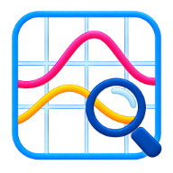

<h1 align="center">ArDiRec</h1>

<strong>Disturbance records, clearly understood.</strong>

Open-source COMTRADE analysis for protection, commissioning, and power-system engineers.

  <a href="https://masarray.github.io/ardirec/">Website</a> ·
  <a href="https://github.com/masarray/ardirec/releases/latest">Download</a> ·
  <a href="docs/GETTING_STARTED.md">Getting started</a> ·
  <a href="https://github.com/masarray/ardirec/issues">Support</a>

ArDiRec brings **waveforms, digital events, measurements, and electrical analysis** together in a single desktop workspace. Open a relay disturbance record, find the important moments, and examine how the system behaved before, during, and after an event.

Works with COMTRADE recordings from different equipment vendors. Designed for manual engineering analysis with clear signal context and responsive navigation.

## Download ArDiRec

**Latest public release: [v0.2.0 Stable](https://github.com/masarray/ardirec/releases/tag/v0.2.0)**

| Platform | Download | What is included |
| --- | --- | --- |
| Windows 10/11 · x64 | **[Download for Windows](https://github.com/masarray/ardirec/releases/download/v0.2.0/ArDiRec-v0.2.0-Windows-x64-Setup.zip)** | ZIP containing a Windows setup wizard |
| Linux · x86_64 | **[Download for Linux](https://github.com/masarray/ardirec/releases/download/v0.2.0/ArDiRec-v0.2.0-Linux-x86_64-Setup.zip)** | ZIP containing a Debian package and AppImage |

Extract the ZIP, then run the installer or AppImage. Check the [SHA-256 checksums](https://github.com/masarray/ardirec/releases/download/v0.2.0/SHA256SUMS.txt) before installing. The Windows installer is currently unsigned and may trigger SmartScreen.

## Explore the event

| Time signals | Electrical analysis |
| --- | --- |
| Inspect synchronized analog waveforms and digital status transitions. | View one-cycle RMS, phasors, harmonics, and impedance trajectories. |
| Zoom, pan, and measure event timing with two cursors (C1 and C2). | Examine values in the table and use primary/secondary scaling when valid recording metadata is available. |
| Follow the trigger reference across signals. | Overlay supported RIO/XRIO protection characteristics for distance analysis. |

ArDiRec supports COMTRADE `.cfg`/`.dat` recordings with ASCII, BINARY, BINARY32, and FLOAT32 data. Compatibility with vendor-specific files and optional metadata varies; see [supported formats and limitations](docs/COMTRADE_COMPATIBILITY.md).

## From record to insight

1. **Open a recording.** Keep the `.cfg` and matching `.dat` files together, then open the `.cfg` in ArDiRec.
2. **Find the event.** Select voltage, current, and digital channels; zoom into the relevant interval and place C1/C2 to measure timing.
3. **Review the electrical response.** Compare waveforms with RMS, phasor, harmonics, impedance, and table views. Confirm units and primary/secondary scaling.

[Read the getting-started guide](docs/GETTING_STARTED.md) · [Frequently asked questions](docs/FAQ.md)

## Help and documentation

Encountered a file that will not open, or a result that looks incorrect? [Report an issue](https://github.com/masarray/ardirec/issues) with your operating system, ArDiRec version, COMTRADE format, and reproduction steps. Only attach recordings you are authorized to share.

For detailed information, see [Compatibility](docs/COMTRADE_COMPATIBILITY.md), [Release notes](RELEASE_NOTES.md), and [Changelog](CHANGELOG.md).

ArDiRec focuses on **manual disturbance investigation**; it does not automatically determine fault causes or guarantee support for every proprietary recording extension. Always verify critical interpretations using your approved engineering procedures.

## Open source

ArDiRec is developed in C++20 and Qt Quick and is licensed under [GPL-3.0-or-later](LICENSE). You can inspect the implementation, build from source, report defects, and contribute improvements.

[Build and contribution guide](CONTRIBUTING.md) · [Architecture](docs/ARCHITECTURE.md) · [Security reporting](SECURITY.md)
